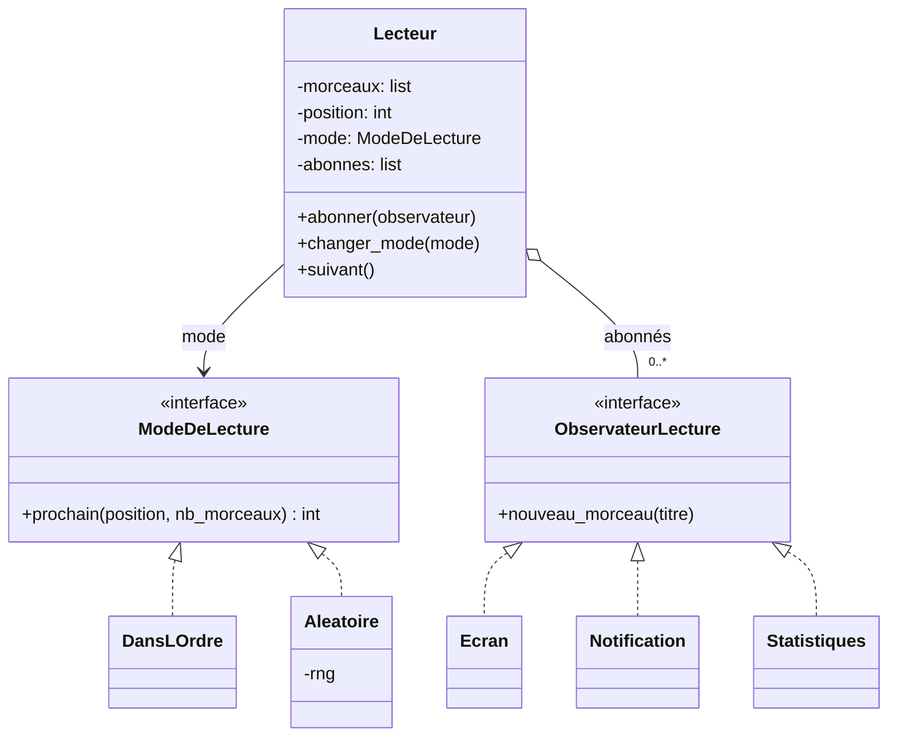

# Contrôle · Corrigé et barème

**B2 · Conception POO & Design Patterns · Jour 6 · 1 heure · /20**

Répartition conseillée du temps : partie A 15 min, partie B 15 min, partie C 30 min.

---

## Partie A · QCM (8 points)

| Question | Réponse | Explication (à donner en correction) |
|---|---|---|
| A1 | **B** `['épée']` | `objets` est un attribut **de classe** : la liste est partagée par toutes les instances. Il faut l'initialiser dans `__init__` (jour 1). |
| A2 | **B** | Une propriété s'utilise comme un attribut mais exécute du code : validation, valeur calculée. Elle ne rend rien « privé » (jour 1). |
| A3 | **B** `TypeError` | Une classe abstraite qui a des méthodes abstraites ne peut pas être instanciée (jour 2). |
| A4 | **B** ouvert/fermé | Ajouter un type oblige à modifier la fonction. Solution : polymorphisme, chaque produit calcule son prix (jour 3). |
| A5 | **C** | État global caché : couplage, tests qui s'influencent (d'où la remise à zéro dans `conftest.py`) (jour 4). |
| A6 | **C** | Même interface, objet enveloppé dans les deux cas ; c'est l'intention qui les distingue (jour 5). |
| A7 | **A** Observer | Le sujet notifie des abonnés qu'il ne connaît que par une interface (jour 6). |
| A8 | **B** Strategy | Algorithme interchangeable à l'exécution. State : c'est l'objet lui-même qui change d'état et de comportement (jour 6). |

---

## Partie B · Reconnaître les patterns (4 points)

Par extrait : 0,5 pt pour le nom, 0,5 pt pour une justification qui parle de l'**intention** ou de la **structure caractéristique**.

| Extrait | Pattern | Justification attendue |
|---|---|---|
| B1 | **Singleton** | `__new__` renvoie toujours la même instance stockée dans `_instance` : une seule configuration pour tout le programme. |
| B2 | **Proxy** (de cache) | Même interface que le service réel (`temperature`), qu'il enveloppe ; il **contrôle l'accès** en évitant les appels répétés. *Accepter « Decorator » à 0,5 pt si la justification parle d'enveloppe avec la même interface, sans parler de contrôle d'accès.* |
| B3 | **Template Method** | `generer()` fixe l'ordre des étapes ; les sous-classes ne redéfinissent que certaines étapes (`corps` obligatoire, `entete`/`pied` facultatives : crochets). |
| B4 | **Command** | L'action est un objet avec `executer()` et `annuler()` ; le bouton (invocateur) ne sait pas ce qu'il fait, et l'historique permet le Ctrl+Z. |

---

## Partie C · Conception : le lecteur de musique (8 points)

### C1. Patterns (1 pt)

- **Strategy** pour le mode de lecture (0,5) : l'algorithme « quel est le morceau suivant ? »
  est interchangeable, même pendant la lecture ; un nouveau mode = une nouvelle classe.
- **Observer** pour l'écran, la notification et les statistiques (0,5) : le lecteur publie,
  des abonnés réagissent, sans qu'il les connaisse.

*Accepter State à 0,25 pt pour le mode si l'étudiant justifie correctement ; ce n'est pas le meilleur choix, car c'est l'utilisateur qui choisit le mode et non le lecteur qui change d'état tout seul.*

### C2. Diagramme de classes (3 pts)



Barème :

- interface (ou classe abstraite) des modes, avec deux implémentations : 1 pt ;
- interface des observateurs, avec au moins deux implémentations : 1 pt ;
- relations correctes (implémentation, association ou agrégation vers les interfaces, **jamais vers les classes concrètes**) avec des flèches dans le bon sens : 0,5 pt ;
- attributs et méthodes cohérents avec le code de C3 : 0,5 pt.

### C3. Code (3 pts)

```python
import random
from typing import Protocol


class ModeDeLecture(Protocol):
    def prochain(self, position: int, nb_morceaux: int) -> int: ...


class DansLOrdre:
    def prochain(self, position, nb_morceaux):
        return (position + 1) % nb_morceaux


class Aleatoire:
    def __init__(self, rng=None):
        self.rng = rng or random.Random()      # hasard injecté : testable

    def prochain(self, position, nb_morceaux):
        return self.rng.randrange(nb_morceaux)


class Lecteur:
    def __init__(self, morceaux, mode=None):
        self.morceaux = morceaux
        self.position = 0
        self.mode = mode or DansLOrdre()
        self._abonnes = []

    def abonner(self, observateur):
        self._abonnes.append(observateur)

    def changer_mode(self, mode):
        self.mode = mode

    def suivant(self):
        self.position = self.mode.prochain(self.position, len(self.morceaux))
        titre = self.morceaux[self.position]
        for observateur in self._abonnes:
            observateur.nouveau_morceau(titre)
        return titre


class Ecran:
    def nouveau_morceau(self, titre):
        print(f"♪ {titre}")
```

Barème :

- modes : interface et deux classes, hasard injecté (paramètre `rng` ou équivalent) : 1 pt ;
- `Lecteur` : délègue le calcul au mode, **sans aucun `if` sur le type de mode** : 1 pt ;
- notifications : liste d'abonnés, boucle d'appel, `Ecran` : 1 pt.

Erreurs fréquentes à pénaliser (−0,5 chacune) :

- `if self.mode == "aleatoire"` dans `Lecteur` : ce n'est plus un Strategy ;
- `self.ecran.afficher(…)` en dur dans `Lecteur` : ce n'est plus un Observer ;
- `random.choice` appelé directement, sans possibilité de contrôle dans les tests.

### C4. SOLID (1 pt, 0,5 par principe correctement justifié)

- **O, ouvert/fermé** : un nouveau mode ou un nouvel observateur s'ajoute sans modifier `Lecteur`.
- **D, inversion des dépendances** : `Lecteur` dépend d'abstractions (`ModeDeLecture`, `ObservateurLecture`) et non de classes concrètes ; les modes sont injectés.
- **S, responsabilité unique** : le lecteur gère la lecture ; l'affichage, les notifications et les statistiques sont ailleurs.
- **L, substitution de Liskov** : tout mode peut remplacer un autre sans que le lecteur s'en aperçoive.

---

## Barème récapitulatif

| Partie | Points |
|---|---|
| A · QCM | 8 |
| B · Reconnaître les patterns | 4 |
| C · Conception (C1 1, C2 3, C3 3, C4 1) | 8 |
| **Total** | **20** |

Rappel : le contrôle compte pour **40 %** de la note du module, le projet pour **60 %**.
